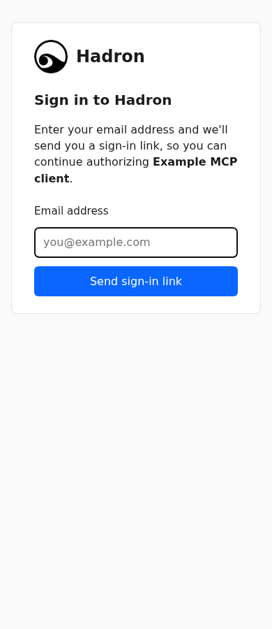
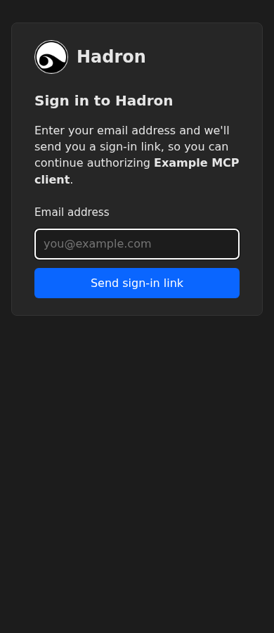
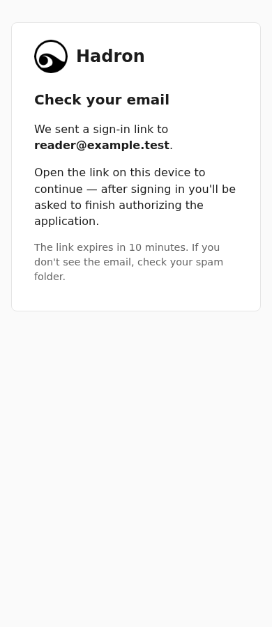
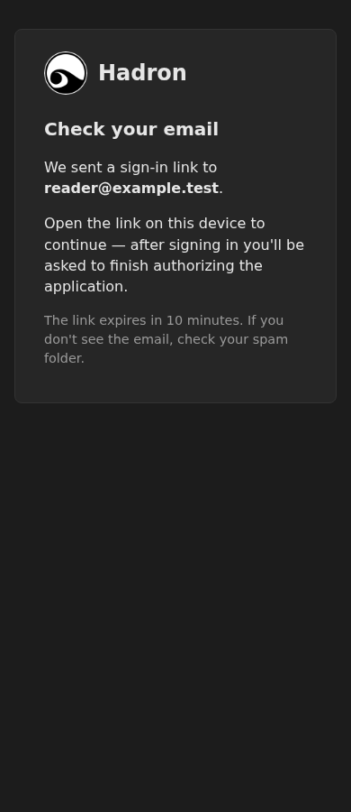
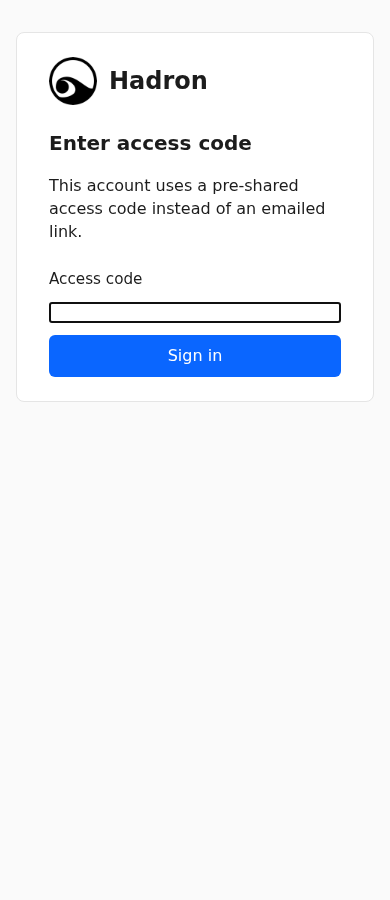
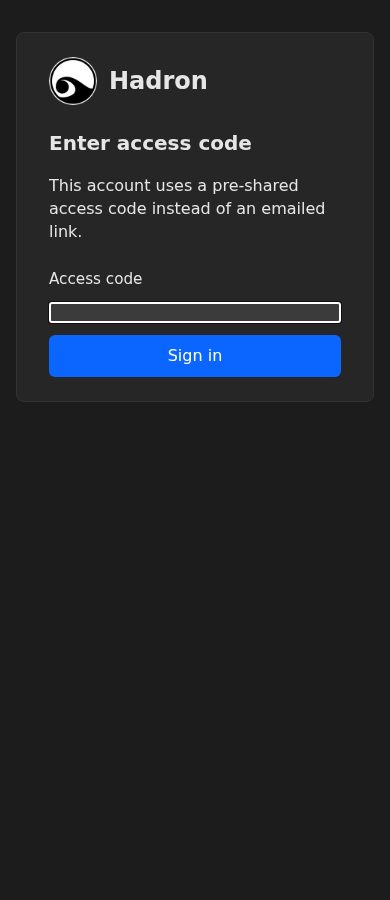
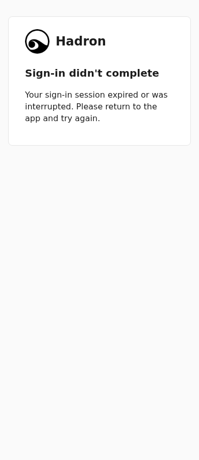
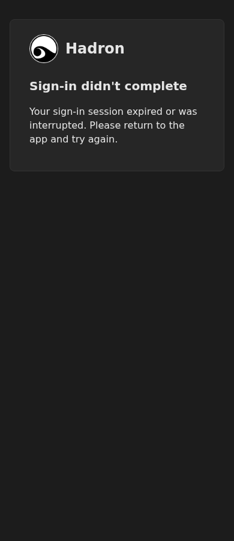

# OAuth header layout evidence

Static synthetic template renders in local headless Chromium1208, device scale1, at320/390/1280×900 in light/dark. All six templates were rendered at each size/scheme (36 current renders +36 pre-PR-main baseline renders). The browser assertion preserves the original546px desktop outer card width; current pages have no horizontal overflow, loaded128×128 embedded logos, and zero HTTP(S)resource requests. This is author static evidence, not a live OAuth round trip or independent QA.

The frozen17fc0e29 head failed all12 desktop equality cells (546→480). Sizing now belongs to each page stylesheet, with the original480px content+4rem horizontal padding+2px border desktop maximum preserved. At390px the old and new outer width is358px; the containment improvement is at320px, not a claimed390px overflow fix.

Re-run from this checkout with a detached pre-PR baseline checkout at6d6b25bfc4f93f3d1ca8f201b76fe057f526684c and operator-installed Playwright/Chromium:

```sh
OAUTH_LAYOUT_BROWSER=/absolute/path/to/chromium node_modules/.bin/tsx scripts/e2e/oauth-header-layout.ts /absolute/path/to/baseline /absolute/path/to/playwright-core/index.mjs /absolute/path/to/private-output
```

No dependency install, local/remote server, production origin or real data is used by this script. `layout-results.json` retains every measured current/baseline width and palette.

| Page |390px light|390px dark|
|---|---|---|
|Sign-in|||
|Email entry|||
|Email sent|||
|Review code|||
|Consent|||
|Login error|||

Desktop captures: [sign-in light](signin-light-1280.png), [sign-in dark](signin-dark-1280.png), [consent light](consent-light-1280.png), [consent dark](consent-dark-1280.png). The other desktop cells are retained as measured rows in the JSON report.
