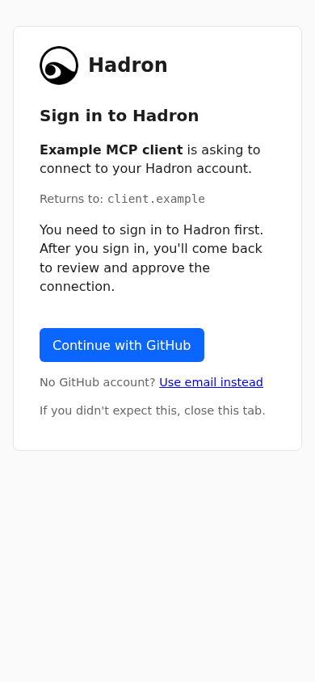
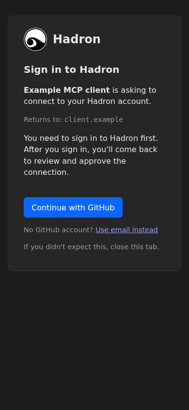
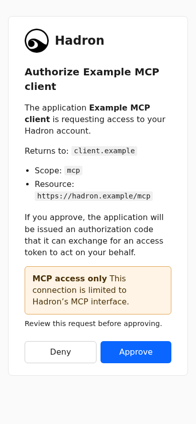
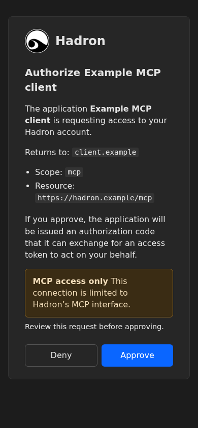

# OAuth header at 390px

Rendered from the sign-in and consent templates with synthetic placeholder values, in local headless Chromium 1208, viewport 390×844, device scale 1. Screenshots cover light and dark `prefers-color-scheme`; each document had scroll width 390px and made zero HTTP(S) requests. This is static template evidence, not a live OAuth round trip or independent QA.

| Page | Light | Dark |
| --- | --- | --- |
| Sign-in |  |  |
| Consent |  |  |
